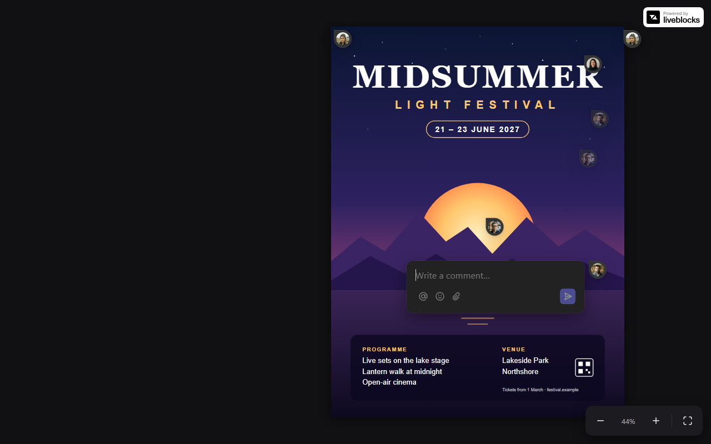
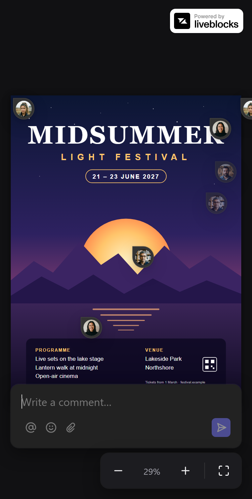
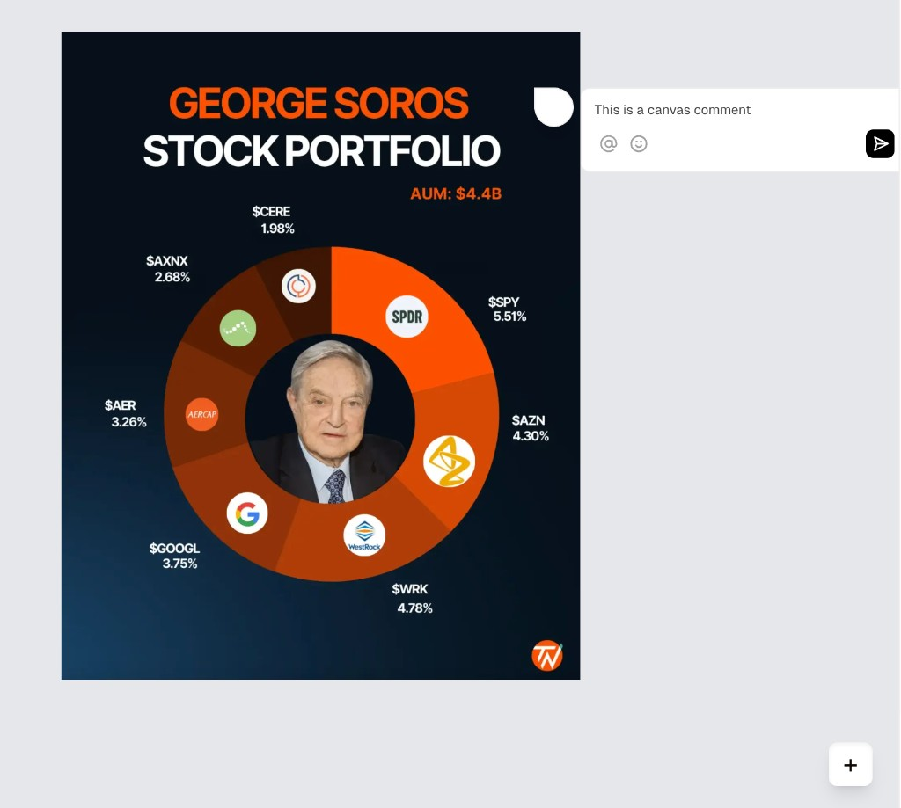
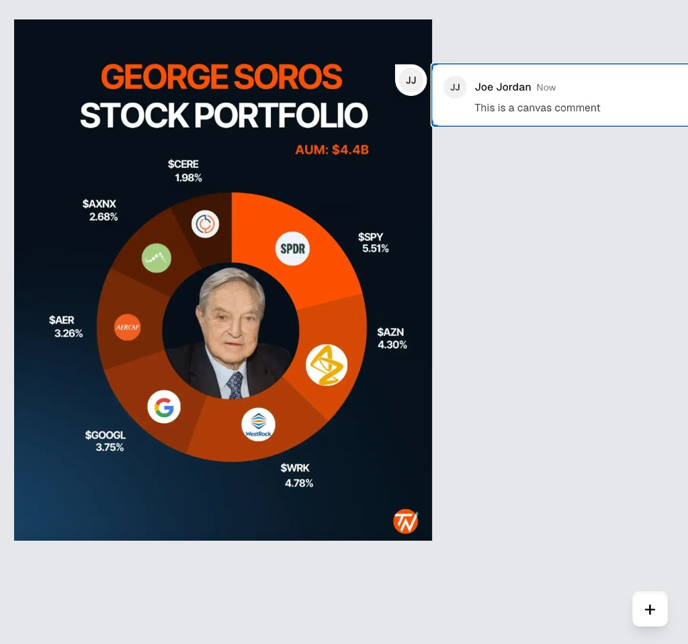

# Image comments

Click anywhere on an image to start a comment thread at that exact spot. Pan and zoom the image; every comment stays on its spot. Threads near the right edge open inwards, and on a phone they open as a sheet. Comments are shared in real time through [Liveblocks](https://liveblocks.io).

Built on the [Liveblocks canvas comments example](https://github.com/liveblocks/liveblocks/tree/main/examples/nextjs-comments-canvas) (Next.js 16, React, Liveblocks 3.23). Part B of the case study below; Part A is not done.

| Desktop: the thread opens inwards near the right edge                                                                                                                          | Phone: the thread opens as a bottom sheet                                                                                                         |
| ------------------------------------------------------------------------------------------------------------------------------------------------------------------------------ | ------------------------------------------------------------------------------------------------------------------------------------------------- |
|  |  |

## Quick start

You need Node.js 20.9 or newer (developed on Node 26) and a free Liveblocks account.

```bash
npm install
```

Copy `.env.example` to `.env.local` (`cp .env.example .env.local` on macOS or Linux, `copy .env.example .env.local` on Windows) and set `LIVEBLOCKS_SECRET_KEY` to the **secret** key (it starts with `sk_`) from your Liveblocks dashboard at <https://liveblocks.io/dashboard/apikeys>. Then:

```bash
npm run dev        # http://localhost:3000
```

| Script                        | What it does                |
| ----------------------------- | --------------------------- |
| `npm run dev`                 | Development server          |
| `npm test`                    | 125 unit tests (Vitest)     |
| `npm run build` / `npm start` | Production build and server |

Good to know:

- Comments live in the Liveblocks room `liveblocks:examples:image-comments` of the project your key belongs to.
- Each browser is one of eight fake users (names from `src/database.ts`), picked at random and remembered in a cookie. Open a second browser or a private window to see real-time collaboration between two users (one time in eight it picks the same user; open another private window).
- Without a key, or if Liveblocks is unreachable, the image still pans and zooms and a notice says there are no comments. If it says "Can't reach the comment server", check `LIVEBLOCKS_SECRET_KEY` in `.env.local` and restart the dev server.

## What you can do

| Brief                                                     | How it works here                                                                                                                                                                   |
| --------------------------------------------------------- | ----------------------------------------------------------------------------------------------------------------------------------------------------------------------------------- |
| Click anywhere on the image to add a comment at that spot | Click (or tap) the image: a composer opens at the spot. Send with Enter or the button. A press that moves 4 px or more is a drag, not a click                                       |
| Threads open inwards near the right edge                  | A thread opens right of its pin when it fits before the right edge of the visible canvas, otherwise left. On a screen too narrow for either side, it opens as a sheet at the bottom |
| Comments stay correct at every zoom level                 | Each comment is stored as a fraction of the image size and drawn through the same transform as the image (see below)                                                                |
| Drag the image to pan                                     | Mouse, pen or one finger                                                                                                                                                            |
| Zoom in and out controls                                  | `-`, `+` and "Fit to screen" (bottom right), mouse wheel and trackpad pinch around the cursor, two-finger pinch on touch screens. 10% to 800%                                       |
| Optional: responsive                                      | Bottom sheet on narrow screens, 44 px touch targets for pins, smaller margins on phones                                                                                             |
| Optional: editing comments                                | "..." menu on your own comments: edit, delete. Reply, react and resolve in any thread                                                                                               |
| Error handling                                            | See [States and errors](#states-and-errors)                                                                                                                                         |

Other details: click a pin to open its thread, click it again or anywhere else to close it. Escape closes too and gives keyboard focus back to the pin. A click while a thread is open only closes it; the next click starts a comment. Dragging and zooming keep the open thread open and attached to its pin.

## How it works

### Comments stay on their spot

Three coordinate systems, two conversions:

```
stored anchor  (0..1)        x: 0.62, y: 0.31          fraction of the image size, saved in Liveblocks
   x natural size
image point    (px)          x: 744, y: 496            pixel of the image at 100%
   x scale + offset
screen point   (px)          where the pin is drawn    relative to the canvas
```

The pan and zoom state is one object, `{ x, y, scale }`: `screen = image * scale + (x, y)`. The image is drawn with that transform as a CSS `translate(...) scale(...)`. The pins are drawn in a separate, unscaled layer, each at `getScreenPointFromNormalized(anchor, imageSize, transform)`, so they keep their size and land on their spot at any zoom. A click goes the other way with `getNormalizedPointFromScreen`. Both are pure functions in `src/canvas/canvas-math.ts`, and the tests check the two properties that matter: a pin lands exactly where you clicked, and it stays on the same image pixel under any pan and zoom.

Storing fractions instead of pixels also means the anchors survive a higher or lower resolution version of the same image.

### One pan and zoom state

`src/canvas/use-canvas-transform.ts` holds the transform. What it stores starts as `null`, meaning "fit to screen": the hook then computes the fit from the image and window sizes, so the image keeps fitting while the window resizes. The first pan or zoom stores a real transform; "Fit to screen" sets it back to `null`. Zooming keeps the point under the cursor (or between two fingers) fixed: take the image point under it, apply the new scale, solve for the offset. Every update builds on the latest state, because several pointer events can arrive before React renders.

### Where a thread opens

`src/comments/comment-layout.ts`, pure and tested:

| Fits right of the pin | Fits left | Opens                       |
| --------------------- | --------- | --------------------------- |
| yes                   | any       | right                       |
| no                    | yes       | left (inwards)              |
| no                    | no        | as a sheet along the bottom |

"Fits" uses the fixed thread width (320 px), never a measured one, so typing or a growing thread can never flip it; only the pin moving (pan, zoom) or the window resizing can. Vertically, a panel slides up just enough to stay above the zoom controls, but never so far that it stops overlapping its pin.

The thread and the composer are Liveblocks' own `Thread` and `Composer`, placed in a panel positioned by these rules. The example's `FloatingThread` was not used: it flips on its own and closes as soon as you press outside it, so dragging the image would close the thread.

### States and errors

One function, `getCommentsNotice` in `src/comments/comments-status.ts`, picks the single notice to show, so notices never stack. In priority order, the first that applies wins:

| Situation                                                   | Notice                                                                    |
| ----------------------------------------------------------- | ------------------------------------------------------------------------- |
| Liveblocks refuses the connection (for example, no key)     | "Can't reach the comment server", reload advised                          |
| The server rejected a save (reply, edit, resolve, reaction) | Dismissible error                                                         |
| Connection lost for more than 5 s                           | "Connection lost. Reconnecting..." until it is back; pins stay            |
| Comments failed to load                                     | "Could not be loaded yet. Trying again..." (Liveblocks retries by itself) |
| Loading                                                     | "Loading comments..."                                                     |
| No comments yet                                             | "Click anywhere on the image to add one"                                  |

Handled elsewhere:

| Situation                                     | What you see                                                                                   |
| --------------------------------------------- | ---------------------------------------------------------------------------------------------- |
| Your new comment failed to post, also offline | The composer reopens at the same spot with your text and an inline error (`comment-layer.tsx`) |
| Empty comment                                 | Send is disabled (Liveblocks' composer)                                                        |
| The image fails to load                       | Error card with "Try again" (`image-canvas.tsx`)                                               |
| The comment layer crashes                     | Error boundary notice; the image keeps working (`image-comments.tsx`)                          |

Not handled: a reply, edit, resolve or reaction made while offline. Liveblocks reports only failures the server answered, so an offline one is rolled back without a message (the "Connection lost" notice appears after 5 s, but a typed reply is lost). New comments have the same blind spot and are covered by watching for the comment disappearing; replies are not, yet.

### Users

There is no login: `src/app/api/liveblocks-auth/route.ts` gives each browser one of eight fake users. The starter picked a random one on every request, so after a reload you could no longer edit your own comments. `src/proxy.ts` now stores the user in a cookie on the page request, before Liveblocks sends its (parallel) auth requests.

## Project map

```
src/
  app/                       Next.js page, layout, providers (from the example)
    api/liveblocks-auth/     Liveblocks access tokens for this browser's fake user
    api/users/               names and avatars for Liveblocks
  proxy.ts                   sets the fake user cookie on the page request
  canvas/                    the image, pan and zoom; knows nothing about comments
    canvas-math.ts           coordinate math (tested)
    use-canvas-transform.ts  the one pan and zoom state
    use-canvas-gestures.ts   drag, pinch, wheel, tap
    image-canvas.tsx         puts it together and renders the comment layer on top
  comments/                  everything Liveblocks: pins, threads, notices
    comment-layout.ts        where a thread opens (tested)
    comments-status.ts       which notice to show (tested)
    comment-layer.tsx        pins, open thread, new comment, errors
    image-comments.tsx       what is open, connects the canvas and the comments
  users/user-identity.ts     cookie value to fake user (tested)
public/poster.svg            the image (a made-up poster)
```

## Testing

`npm test` runs 125 unit tests on the pure logic: coordinates, zoom, pinch, thread placement, notices, user cookie. Behaviour that needs a browser (pinch, touch taps, offline, flip at the edge) was checked during development by driving a headless browser through the Chrome DevTools protocol; those checks and their results are recorded in each step's spec, not committed as an automated suite. Component tests with Testing Library are not written yet.

## Decisions and limits

- **Fake users.** Anyone can switch user by editing the cookie. Fine for a demo; a real app needs real authentication.
- **No keyboard way to place a new comment.** Pins, threads and zoom controls work with the keyboard; placing a pin needs a pointer.
- **Every pin re-renders on each pan frame.** Not profiled; smooth with the handful of pins used here, and it keeps the anchoring math in one tested function.
- **Offline replies, edits and reactions fail silently** (see [States and errors](#states-and-errors)).
- **A sheet can cover the pin it belongs to** on a phone; pan to see it.
- **The Liveblocks free-plan badge** is moved to the top right, off the zoom controls.

## How it was built

The first commits import the example almost unchanged (two fixes: it could not build without a key, and `next dev` wrote its own rules into `AGENTS.md`). The work went in seven steps: starter, pan and zoom, anchored comments, flip, error states, responsive and editing, this README. Each step has a spec and a plan in `.agents/specs/` and `.agents/plans/`, small commits of at most five files, and from step 2 on each commit type-checked on its own and a code review before handover. Each spec lists what was verified, the review findings and what changed because of them.

## AI usage

**Tool:** Claude Code, the only AI tool used. Its rules live in `AGENTS.md` (Claude Code reads it through `CLAUDE.md`), with project skills (spec, test, review) and subagents in `.claude/`.

**What I used it for:**

- Reading the example and the Liveblocks and Next.js sources in `node_modules` before relying on any API; the specs tag every such claim as verified (with file and line) or assumed.
- Writing the specs, plans, code and unit tests, one step at a time, each step handed back to me to review and commit myself.
- Checking behaviour in a headless browser (pinch, touch taps, offline, the flip at the edge), which unit tests cannot cover.
- A separate code-review agent after every step from step 2 on; it found real bugs, listed below.

**What I decided:** how to work (Part B first, one spec per feature, small commits, a review after each step), where the brief was ambiguous (threads flip at the visible canvas edge, as in the design reference, not at the image edge), and every commit: the AI prepared each one, I reviewed and made it.

**What the AI got wrong, and what changed:**

| What happened                                                                                                | Why it mattered                                                                                                                                              | What changed                                                                                |
| ------------------------------------------------------------------------------------------------------------ | ------------------------------------------------------------------------------------------------------------------------------------------------------------ | ------------------------------------------------------------------------------------------- |
| It proposed loosening the Vitest version to `^4.1.12` to match the example's style                           | Vitest 5 had just failed to install next to the example's dependencies; I wanted the version that was actually checked                                       | I rejected it; Vitest stays pinned to `4.1.12`                                              |
| It assumed Liveblocks reports every failed save                                                              | A comment posted while offline vanished without a message and its text was lost: network failures are re-thrown without an event (found by the review agent) | The app watches for its own new comment disappearing and reopens the composer with the text |
| It assumed one auth request per page load, and tested the user cookie with requests sent one after the other | On a first visit Liveblocks sends two auth requests at once, and each got a different random user (found by the review agent)                                | `src/proxy.ts` sets the cookie before the page's scripts run                                |

More in `.agents/ai-usage-log.md` and the corrections logs of each spec.

---

The case study brief, unchanged:

# Full Stack Developer Case Study

Thank you for taking part in our hiring process. This case study is the second stage. It has one required coding task (Part B) and one optional written task (Part A).

**Deadline:** please submit within **72 hours** of receiving this link.

# Rules

1. **AI tools are allowed.** You may use any AI coding tools you like (Copilot, Cursor, Claude, ChatGPT and similar). The team you would join uses AI every day. What matters is that the result is good and that you understand it.
2. **You will explain it live.** If you move to the next stage, you will walk the team through your code and explain your decisions, line by line if asked. Only submit code you can fully explain, whoever or whatever wrote it.
3. **Add an AI usage note.** In your README, add a short section called "AI usage" covering: which tools you used, what you used them for, and at least one thing the AI got wrong or that you changed, and why.
4. **Commit in small steps.** Make regular commits with clear messages as you work. Your commit history helps us see your process.
5. **Partial is fine.** Focus on doing the core features well. A clean, working subset beats a rushed, complete one.

# Part B: Image Commenting App (Required)

Build a React app that lets users add comments to an image on a canvas, similar to commenting in design tools like Figma. Use [Liveblocks](https://liveblocks.io/docs) as the real time collaboration layer.

## Starter code

Start from the official Liveblocks canvas comments example:
[Liveblocks Canvas Comments Example](https://github.com/liveblocks/liveblocks/tree/main/examples/nextjs-comments-canvas)

Clone it, run `npm install` and `npm run dev`, and build from there.

**Liveblocks key:** the example needs a Liveblocks API key. Create a free account at [liveblocks.io](https://liveblocks.io), copy your secret key from the dashboard, and follow the example's README to add it to `.env.local`. Do **not** commit your key.

## Core features

**1. Image comments**

- Click anywhere on the image to add a comment anchored to that exact spot.
- Comment threads flip between left and right alignment based on position. If a comment is too close to the right edge of the image, it should open inwards.
- Comment positions must stay correct at every zoom level, so each comment stays on its original anchor point.

**2. Canvas interactions**

- Drag the image to pan.
- Zoom in and out controls.
- Comments keep their position relative to the image while panning and zooming.

## Optional features

- Responsive design for different screen sizes.
- Editing existing comments.

## Design reference

Use these as a guide. Working functionality matters more than matching the design exactly.






You may improve the design or add libraries if they help usability. Any icon library is fine.

## How we evaluate

Since AI tools are allowed, we care most about the quality of your decisions: how the code is structured, how you solved the hard parts (comments staying anchored through zoom and pan, the left and right flip), how you handle errors, and how well you can explain all of it.

- **Functionality:** does the app work as expected?
- **Code quality:** is the code organised, clean, maintainable and testable?
- **State management:** is state handled efficiently across components?
- **Error handling:** how does the app behave when things go wrong (for example a failed connection, an empty comment, or an image that does not load)?
- **UI and UX:** is the experience thoughtful and easy to use?

**Time expectation:** about 4 hours.

# Part A: Product Thinking (Optional)

This part is optional. Complete it if you have time. It is a good chance to show how you think about building the right thing, not just building things right.

Write your answer in `RESPONSE.md`. No code is needed. Expect about 60 to 90 minutes.

## The request

A customer of a content review platform has asked for this feature:

> "Users should be prevented from submitting for review until all AI suggestions have been actively reviewed and given a response."

## Product context

The platform helps teams prepare content before it goes to a human reviewer for approval. A typical flow:

1. A user creates or edits a piece of content.
2. The platform's AI generates suggestions about issues in that content.
3. The user can look through those suggestions.
4. The user submits the content for human review.

Today, users can submit for review without explicitly responding to the AI suggestions.

You have also heard from three stakeholders:

- One says users skip obvious AI suggestions, which creates unnecessary review rounds.
- Another wants a clearer audit trail showing that suggestions were considered.
- A third worries that a blanket rule will add friction and slow people down.

## Your task

Answer three things in `RESPONSE.md`:

1. **Questions you would ask.** What would you ask the customer or internal stakeholders to understand the problem and avoid building the wrong thing?
2. **How you would learn more without them.** The customer is unavailable for a week. What data, product behaviour, people or other sources would you look at to reduce uncertainty?
3. **A developer ready ticket.** Write the ticket you would hand to engineering. It should be specific enough to estimate and start work, and should clearly list open questions, assumptions and dependencies.

You do not need to design the UI in detail. Make reasonable assumptions and label them clearly. We care more about your thinking than finding one correct answer.

# How to submit

1. Click **Use this template** at the top of this repository to create your own copy (or clone it).
2. Build Part B in your repository, and add setup instructions to your README so we can run it in a few minutes.
3. If you do Part A, write it in `RESPONSE.md`.
4. Push your work to your own GitHub repository. If it is private, give access to this GitHub account.
5. Email the link to **info@limitlessoutsourcing.com** with the subject "Case Study: Your Full Name".

Good luck. We look forward to seeing your work.

Limitless Outsourcing Team
